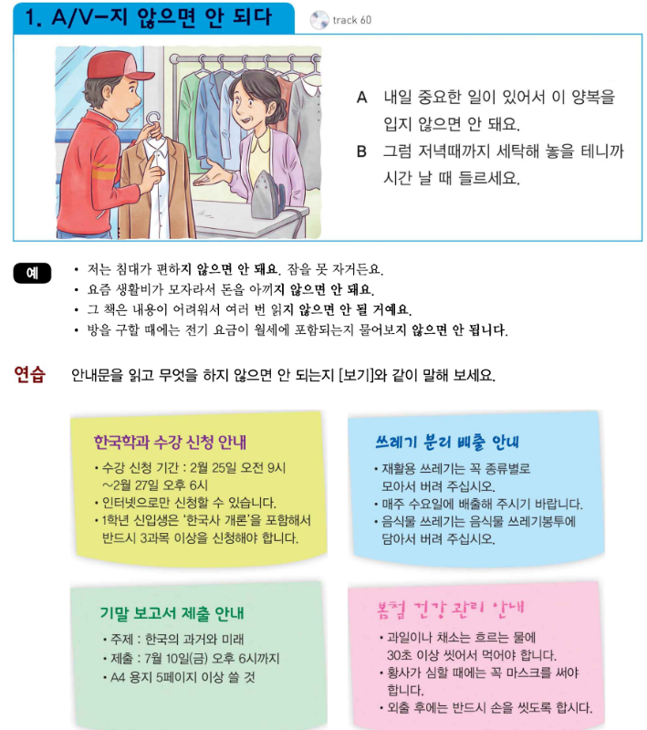
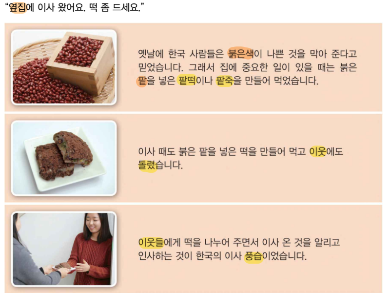

# Seoul 3B - Bài 15: 전기를 아껴 쓰지 않으면 안 돼요

주거 생활: Đời sống cư trú

수돗물: tap water

변기: Toilet

새다: leak

계약: contract, agreement

보증: gurantee

연체: being overduej

(nếu bạn không tiết kiệm điện là không được đâu)

월세: thuê hàng tháng

전세: trả 1 lần 2-3 năm

포함되어 있어요

밀리다: nước/ xe cộ bị dồn ứ/ tiền thuê bị dồn lại

### 1. 수돗물이 안 나오다 (cúp nước)

- 아침에 **갑자기** 수돗물이 안 나와서 샤워를 못 했어요. *(Sáng tự nhiên bị cúp nước nên tôi không tắm được)*
- 공사 때문에 하루 종일 수돗물이 안 나온대요. *(Do thi công nên cả ngày không có nước)*

### 2. 전기가 나가다 / 정전되다 (cúp điện)

- 어제 밤에 전기가 나가서 아무것도 못 했어요. *(Tối qua bị cúp điện nên không làm được gì)*
- 태풍 때문에 정전돼서 엘리베이터가 멈췄어요. *(Do bão nên mất điện, thang máy dừng lại)*

### 3. 변기가 막히다 (bồn cầu bị nghẹt)

- 휴지를 너무 많이 넣어서 변기가 막혔어요. *(Cho quá nhiều giấy nên bồn cầu bị nghẹt)*
- 변기가 막혀서 관리실에 연락했어요. *(Bồn cầu bị nghẹt nên đã gọi quản lý)*

### 4. 물이 새다 (rò rỉ nước)

- **천장**에서 물이 새고 있어요. *(Nước đang rò từ trần nhà)*
- 싱크대 밑에서 물이 새는 것 같아요. *(Hình như nước rò dưới bồn rửa)*

### 5. 소음이 심하다 (tiếng ồn nghiêm trọng)

- **옆집**에서 나는 소음이 너무 심해요. *(Tiếng ồn từ **nhà bên cạnh** rất nghiêm trọng)*
- **공사 소음**이 심해서 잠을 못 자요. *(**Tiếng ồn thi công** lớn nên không ngủ được)*

### 6. 난방이 안 되다 (hệ thống sưởi hỏng)

- 겨울인데 난방이 안 돼서 너무 추워요. *(Mùa đông mà không có sưởi nên rất lạnh)*
- 고장 나서 난방이 안 된대요. *(Do hỏng nên không có sưởi)*

### 7. 이상한 냄새가 나다 (có mùi lạ)

- 방에서 이상한 냄새가 나요. *(Trong phòng có mùi lạ)*
- 냉장고에서 이상한 냄새가 나서 청소했어요. *(Tủ lạnh có mùi lạ nên tôi đã dọn)*

### 8. 물이 안 내려가다 (nước không thoát)

- 세면대 물이 안 내려가요. *(Nước bồn rửa không thoát)*
- 샤워실 물이 잘 안 내려가서 불편해요. *(Nước phòng tắm thoát kém nên bất tiện)*

### 9. 계약서 (hợp đồng)

- 계약서를 꼼꼼히 읽어 보세요. *(Hãy đọc kỹ hợp đồng)*
- 저는 교수님과 계약서에 서명했습니다.. *(Tôi đã ký hợp đồng với giáo sư)*

### 10. 계약 기간 (thời hạn hợp đồng)

- 계약 기간은 1년입니다. *(Thời hạn hợp đồng là 1 năm)*
- 계약 기간이 끝나면 갱신해야 해요. *(Hết hạn hợp đồng thì phải gia hạn)*

---

### 11. 계약하다 (ký hợp đồng)

- 오늘 집 계약했어요. *(Hôm nay tôi đã **ký hợp đồng nhà**)*
- 회사와 계약하려고 합니다. *(Tôi định ký hợp đồng với công ty)*

### 12. 보증금 (tiền đặt cọc)

- 보증금이 너무 비싸요. *(Tiền đặt cọc quá đắt)*
- 보증금을 먼저 내야 합니다. *(Phải nộp tiền cọc trước)*

### 13. 공과금 (chi phí điện nước…)

- 공과금이 포함되어 있나요? *(Đã bao gồm tiền điện nước chưa?)*
- 매달 공과금을 **따로 내야 해요**. *(Mỗi tháng phải **trả riêng** tiền điện nước)*

---

### 14. 연체료 (phí trễ hạn)

- 연체료를 내야 할 수도 있어요. *(**Có thể phải trả** phí trễ hạn)*
- 월세를 늦게 내면 연체료가 붙어요. *(Trả tiền nhà trễ sẽ bị phí)*

---

### 15. 포함되다 (được bao gồm)

- 관리비에 수도 요금이 포함돼요. *(Tiền nước được bao gồm trong phí quản lý)*
- 이 가격에 **세금**이 포함되어 있습니다. *(Giá này đã bao gồm thuế)*

### 16. 납부하다 / 내다 (nộp) # 반납하다: Return

- 세금을 **제때** 납부해야 합니다. *(Phải nộp thuế đúng hạn)*
- 공과금을 냈어요. *(Tôi đã trả tiền điện nước)*

### 17. 밀리다 (bị dồn lại)

- 월세가 두 달 밀렸어요. *(Tiền nhà bị trễ 2 tháng)*
- 일이 너무 많아서 일이 밀렸어요. *(Công việc bị dồn lại)*

### 18. 지출 (chi tiêu)

- 지출을 줄여야 해요. *(Phải giảm chi tiêu)*
- 이번 달 지출이 많았어요. *(Tháng này chi tiêu nhiều)*

### 19. 수입 / 소득 (thu nhập)

- 수입이 많지 않아요. *(Thu nhập không nhiều)*
- 안정적인 소득이 필요해요. *(Cần thu nhập ổn định)*

### 20. 늘다 / 줄다 (tăng/giảm – không dùng tiền)

- 실력이 많이 늘었어요. *(Kỹ năng đã tăng lên nhiều)*
- 체중이 줄었어요. *(Cân nặng đã giảm)*

👉 오르다 / 내리다 (giá tiền lên/xuống)

- **물가**가 많이 올랐어요. *(Giá cả tăng nhiều)*
- **집값**이 내렸어요. *(**Giá nhà** giảm)*

---

### 21. 낭비하다 (lãng phí)

- 돈을 낭비하지 마세요. *(Đừng lãng phí tiền)*
- **시간을 낭비**한 것 같아요. *(Có vẻ tôi đã l**ãng phí thời gian**)*

### 22. 아끼다 / 절약하다 (tiết kiệm – dùng ít)

- 전기를 아껴 써야 해요. *(Phải tiết kiệm điện)*
- 물을 절약합시다. *(Hãy tiết kiệm nước)*

### 23. 저축하다 (tiết kiệm tiền – để dành)

- 매달 돈을 저축하고 있어요. *(Mỗi tháng tôi đang tiết kiệm tiền)*
- 미래를 위해 저축해야 합니다. *(Phải tiết kiệm cho tương lai)*

추측: phán đoán 

자동이체: thanh toán tự động

늦은 밤

저에게 용서하다 tha thứ cho tôi

화해하다

# NGỮ PHÁP BÀI 15

## **1. 게 하다** (1, PAGE 210): Làm cho, bắt, cho phép

어머니는 동생에게 집을 청소하게 하셨어요.

⇒ Mẹ bắt em dọn nhà

오늘 사장님은 민수를 **잔업하**게 하셨어요

⇒ Hôm nay giám đốc bắt Minsu làm tăng ca

## 2. A/V을걸요: Chắc là

- Đôi giày này to lắm nên chắc bạn không thể mang được đâu

⇒ 이 신발은 커서 못 신을걸요.

- Nếu bạn trả sách trễ thì chắc phải trả phí trễ hạn

⇒ 책을 늦게 **반납하**면 **연체료**를 내야 할걸요.

## **3. PAGE 217**

## **4. 는 길에**

나가다 (đi ra), 외Q출하다 (ra ngoài), 출근하다 (đi làm), 들어오다 (đi vào), 돌아오다 (trở về), 퇴근하다 (tan làm)

- Trên đường từ công ty về nhà bạn đã có chuyện gì không vui à?

⇒ 회사에서 **가는 길에** 무슨 안 좋은 일이 있었어요? 표정이 안 좋아 보여요

- Trên đường đến công ty tôi ghé vào quán ăn gần công ty dùng sáng

⇒ 회사에 **가는 길에** 화사 근처 음식점에 **들러**서 아침을 먹어요. (출근하다)

## Đoạn hội thoại

**A:** 내일 중요한 일이 있어서 이 양복을 입지 않으면 안 돼요.

→ Ngày mai tôi có việc quan trọng nên **bắt buộc phải mặc bộ vest này**.

**B:** 그럼 저녁때까지 세탁해 놓을 테니까 시간 날 때 **들르다: ghé qua (stop by)**세요.

→ Vậy thì tôi sẽ giặt xong trước buổi tối, khi nào rảnh bạn ghé qua nhé.

## Thông báo 1: Đăng ký lớp tiếng Hàn

**한국학과 수강 신청 안내**

→ Thông báo đăng ký môn học khoa Hàn Quốc học

- **수강** 신청 기간: 2월 25일 오전 9시 ~ 2월 2일 오후 6시
→ Thời gian đăng ký: 25/2 (9h sáng) ~ 2/2 (6h chiều)
- 인터넷으로 신청할 수 있습니다.
→ Có thể đăng ký online
- 1학년 신입생은 한국사 개론을 포함해서 반드시 3**과목** 이상을 신청해야 합니다.
→ Sinh viên năm nhất **phải đăng ký ít nhất 3 môn** (bao gồm nhập môn Hàn Quốc học)

## Thông báo 2: Phân loại rác

**쓰레기 분리 배출 안내**

→ Hướng dẫn phân loại rác

- **재활용** 쓰레기는 꼭 **종류별**로 **모아서** 버려 주십시오.
→ Rác tái chế **phải phân loại theo từng loại**
- 매주 수요일에 배출해 **주시기 바랍니다**.
→ Vui lòng đổ rác vào mỗi thứ Tư
- **음식물 쓰레기**는 음식물 쓰레기통에 **담**아서 버려 주십시오.
→ **Rác thực phẩm** **phải bỏ vào thùng riêng**

## Thông báo 3: Nộp bài cuối kỳ

**기말 보고서 제출 안내**

→ Hướng dẫn nộp báo cáo cuối kỳ

- 주제: 한국의 과거와 미래
→ Chủ đề: Quá khứ và tương lai của Hàn Quốc
- 제출: 7월 10일(금) 오후 6시까지
→ Hạn nộp: 10/7 (thứ Sáu) trước 6h chiều
- A4 **용지** 5**페이지** 이상 쓸 것
→ Phải viết **ít nhất 5 trang A4**

## Thông báo 4: An toàn sức khỏe

**봄철 건강 관리 안내**

→ Hướng dẫn chăm sóc sức khỏe mùa xuân

- 과일이나 채소는 물에 30초 이상 씻어서 먹어야 합니다.
→ Trái cây/rau **phải rửa ít nhất 30 giây**
- 황사가 심할 때는 꼭 마스크를 써야 합니다.
→ Khi bụi vàng nặng, **phải đeo khẩu trang**
- 외출 후에는 반드시 손을 씻도록 합시다.
→ Sau khi ra ngoài, **nhất định phải rửa tay**·

# DÙ

Ngữ pháp "dù/cho dù" trong tiếng Hàn phổ biến nhất là **A/V-아/어도**, dùng để diễn tả sự nhượng bộ, kết quả vế sau không bị ảnh hưởng bởi vế trước (dù có... thì vẫn). Các cấu trúc khác bao gồm **-더라도** (giả định dù có) và **-(으)ㄴ/는데도**

**Động từ + -(으)러 가다/오다:** Diễn tả mục đích, **"Đi/đến để làm gì"**

***갔다 오다.. nghĩa là.ĐI RỒI VỀ*** nha..왔다 가다. Đến rồi hãy đi...

**면세점**: cửa hàng miễn thuế

**이르다**: reach, arrive

**중간고사: Mid term examination**

기말 시험: Cuối kỳ

# NGỮ PHÁP

1. N만 하다 (adj):

고양이**만 한** 쥐를 본 적이 있어요

1. 

# LISTENING 0:

## 📝 Nguyên văn

여: 샤오밍 학생, 어디 갔다 와요?

남: 네, 아주머니. 운동하고 오는 길에 **장 좀 봐 왔어요.**

여: 그래요? 방에 불도 켜 있고 텔레비전 소리도 들려서 **집에 있는 줄 알았어요.**

남: 죄송합니다. 나가면서 불 끄는 걸 잊었네요.

여: 이거 관리비 **고지서**예요. 보니까 전기 요금이 다른 방보다 많이 나왔네요. 좀 아껴 써야겠어요.

---

## 🇻🇳 Dịch tiếng Việt

**Nữ:** Xiao Ming, em đi đâu về vậy?

**Nam:** Dạ, thưa cô. Trên đường đi tập thể dục về, em tiện mua ít đồ.

**Nữ:** Vậy à? Thấy đèn trong phòng vẫn bật và nghe tiếng TV nên cô tưởng em đang ở nhà.

**Nam:** Em xin lỗi ạ. Lúc ra ngoài em quên tắt đèn.

**Nữ:** Đây là hóa đơn phí quản lý. Xem thì tiền điện của em cao hơn các phòng khác. Em nên tiết kiệm một chút.

# LISTENING 1: 28’51

## 📝 Nguyên văn

켈리: 아주머니, 제 방에 전기가 안 **들어와요**.

아주머니: 전기가 안 들어온다고요? 다른 방은 다 괜찮은데…… **혹시** 전기 요금을 안 낸 거 아니에요?

켈리: 네? 전기 요금을 제가 내야 돼요? 전에 살던 집에서는 관리비에 **포함됐**는데요.

아주머니: **여기선 따로 내야 돼요**. 고지서 못 받았어요?

켈리: 잠시만요. **이거 말씀인가요?** **몇 번 받았는데 무슨 내용인지 몰랐어요.**

아주머니: 이게 고지서예요. **전기 요금이 세 달이나 밀렸네요.**

켈리: **그럼 전기가 다시 들어오게 하려면 어떻게 해야 돼요?**

아주머니: **밀린 요금을 빨리 내세요**. 아마 **연체료**가 **꽤** 될걸요.

켈리: 네, 알겠습니다.

**Ngữ pháp: V/A + 는/(으)ㄴ지, N + 인지**

Cấu trúc này thường được sử dụng để diễn tả nghĩa nghi vấn.

Vế trước **(으)ㄴ/는지** thường dùng để kết hợp với các đại từ để hỏi như **누구, 어디, 어떻게, 왜, 언제, 뭐, 얼마나, 어떤, 어느 …**

Và vế sau **(으)ㄴ/는지** thường kết hợp với các động từ như **알다/모르다** (biết/ không biết), **궁금하다** (thắc mắc, tò mò), **물어보다** ( hỏi), **생각나다** ( nghĩ, nhớ ) , **알아보다** ( tìm hiểu ) , **조사하다** ( khảo sát, điều tra ) , **가르치다** ( dạy ) , **말하다** ( nói ) , **질문하다** ( câu hỏi )

Examples:

- 이 사람은 **누구** **인지** 아세요? Anh có biết người này là ai không ạ?
- 이 음식을 **어떻게** 먹**는지** 몰라요. Tớ không biết ăn món này như thế nào cả.
- 내일 우리 만날 수 있**는지** 알고 싶어요. Tôi muốn biết ngày mai chúng ta có thể gặp nhau hay không.
- **무슨 내용인지 몰랐어요.**

---

## 🇻🇳 Dịch tiếng Việt

**Kelly:** Cô ơi, phòng của cháu không có điện.

**Cô:** Không có điện à? Các phòng khác vẫn bình thường… Cháu có quên trả tiền điện không?

**Kelly:** Dạ? Cháu phải tự trả tiền điện ạ? Ở nhà trước thì đã bao gồm trong phí quản lý rồi.

**Cô:** Ở đây phải trả riêng. Cháu không nhận được hóa đơn sao?

**Kelly:** Đợi chút. Là cái này ạ? Cháu nhận mấy lần rồi nhưng không biết nội dung là gì.

**Cô:** Đây là hóa đơn. Tiền điện đã bị chậm tới 3 tháng rồi.

**Kelly:** Vậy để có điện lại thì cháu phải làm gì ạ?

**Cô:** Nhanh chóng trả tiền còn thiếu đi. Có lẽ phí trễ hạn cũng khá nhiều đấy.

**Kelly:** Dạ, cháu hiểu rồi.

# LISTENING 2: 29’46

## Nguyên văn

줄리앙: 이거 지난주에 맡겼던 양복인데, **소매**에 이상한 얼룩이 생겼어요.

세탁소 주인: 그래요? **맡기**시기 전에는 문제가 없었어요?

줄리앙: 네, **산 지 얼마 안 된 옷이에요**. 몇 번 입지도 않았고요.

세탁소 주인: **저희 직원이 실수한 모양이네요**. 제가 확인했어야 했는데…… 정말 죄송합니다. 다시 세탁해 드리겠습니다.

줄리앙: 저 내일 이 옷을 꼭 입지 않으면 안 돼요. 중요한 면접이 있거든요.

세탁소 주인: 무슨 일이 있어도 오늘까지 **해 놓을 테니까** **저녁에 아무 때나 오세요.**

- **해 놓다:** Làm sẵn, làm trước, chuẩn bị trước.
- **(으)ㄹ 테니까:** Vì sẽ (thể hiện ý chí/dự định của người nói).

줄리앙: **그럼 8시쯤 운동 갔다 오는 길에 들를게요**. **아끼는 옷**이니까 잘 좀 부탁드립니다.

---

## 🇻🇳 Dịch tiếng Việt

**Julien:** Đây là bộ vest tôi gửi tuần trước, nhưng ở tay áo có vết bẩn lạ.

**Chủ tiệm giặt:** Vậy à? Trước khi gửi thì không có vấn đề gì sao?

**Julien:** Vâng, đây là quần áo mới mua chưa lâu. Tôi cũng chưa mặc nhiều lần.

**Chủ tiệm giặt:** Có vẻ nhân viên của chúng tôi đã mắc lỗi. Lẽ ra tôi nên kiểm tra… Thật sự xin lỗi. Tôi sẽ giặt lại cho bạn.

**Julien:** Ngày mai tôi nhất định phải mặc bộ này. Tôi có một buổi phỏng vấn quan trọng.

**Chủ tiệm giặt:** Dù có chuyện gì thì tôi cũng sẽ làm xong trong hôm nay, nên tối bạn đến lúc nào cũng được.

**Julien:** Vậy khoảng 8 giờ, trên đường đi tập về tôi sẽ ghé qua. Đây là đồ tôi rất quý nên mong bạn giúp làm cẩn thận.

**싱싱하다 fresh** 

싱싱한 과일

# LISTENING 3: 30’43

**수리하다**: to fix

**부르다**: call for

**하수구: cống / ống thoát nước (drain)**

남: 누구세요?

여: 안녕하세요? **아래층에 사는 사람인데요.**

남: 네, 무슨 일이세요?

여: **우리 집 화장실 천장에서 물이 새서 왔어요**. 여기 화장실에 **무슨 문제가 있는 것 같은데요.**

남: <u>우리 집 화장실</u>은 **아무 문제가 없는데요**. 우리 집 문제가 아닐걸요.

여: 혹시 **하수구**가 막힌 건 아닐까요?

남: 그러고 보니 요즘 물이 잘 안 **내려가긴 했는데**……

여: 와서 보시면 **아시**겠지만 천장에서 물이 **똑똑 떨어져요**.

남: **그 정도예요**? 그러면 어떻게 하죠?

여: 수리 기사를 불러서 **무슨 문제가 있는지** **확인해 주세요.**

남: 네, 그럼 바로 전화하겠습니다. **불편하게 해 드려서 죄송합니다.**

여: 아니에요. 그럴 수도 있죠. 그럼 부탁드립니다.

---

## 🇻🇳 Dịch tiếng Việt

**Nam:** Ai vậy?

**Nữ:** Xin chào, tôi là người sống ở tầng dưới.

**Nam:** Vâng, có việc gì vậy ạ?

**Nữ:** Trần nhà vệ sinh bên tôi bị rò nước nên tôi sang đây. Có vẻ phòng tắm bên này có vấn đề.

**Nam:** Phòng tắm nhà tôi thì không có vấn đề gì. Có lẽ không phải do nhà tôi đâu.

**Nữ:** Có khi nào cống thoát nước bị tắc không?

**Nam:** Nghĩ lại thì dạo này nước thoát không tốt lắm…

**Nữ:** Nếu sang xem thì anh sẽ biết, nước nhỏ từ trần xuống từng giọt.

**Nam:** Nghiêm trọng vậy à? Vậy phải làm sao đây?

**Nữ:** Vui lòng gọi kỹ thuật viên sửa chữa để kiểm tra xem vấn đề là gì.

**Nam:** Vâng, tôi sẽ gọi ngay. Xin lỗi vì đã gây bất tiện.

**Nữ:** Không sao đâu, chuyện đó cũng có thể xảy ra mà. Vậy nhờ anh nhé.

# LISTENING 4: 31’50

**방을  빼다:** dọn phòng và rời đi

## 📄 **Nguyên văn (Korean)**

**듣기 2**

남: 누구세요?

여: 안녕하세요? 저 아래층 사는 학생인데요.

남: 바바라 학생이 무슨 일이에요? 집에 무슨 문제라도 있어요?

여: 저기…… 이번 달까지만 살고 이사해야 될 것 같아서요.

남: 방을 빼겠다고요? 아직 계약 기간도 많이 남았는데…… 이렇게 갑자기 나가겠다고 하면 곤란하죠.

여: 죄송해요. 사정이 생겨서 갑자기 귀국하게 됐어요.

남: **그럼 어쩔 수 없죠**. 그런데 **대신** 들어올 사람을 구해 놓고 나가지 않으면 안 돼요.

**대신**: substitute

여: **그럼 제가 어떻게 하면 될까요?**

남: 나도 부동산에 전화하겠지만 바바라 학생도 다른 부동산에 말해 놓으세요. 그리고 인터넷에 광고 글을 올려놓으면 빨리 사람을 구할 수 있을걸요.

여: 네, 알겠습니다. 만약 제가 이사 가기 전까지 사람을 못 구하면 어떻게 되는 거죠?

남: 계약 기간이 끝나기 전에 나가는 거니까 다른 사람이 들어오기 전까지 방세를 내야 돼요.

여: 그래요? 그럼 빨리 **서둘러**야겠네요.

---

## 🇻🇳 **Dịch tiếng Việt**

**Bài nghe 2**

Nam: Ai đấy ạ?

Nữ: Xin chào ạ, em là sinh viên sống ở tầng dưới.

Nam: Bạn Barbara có chuyện gì vậy? Nhà có vấn đề gì không?

Nữ: Dạ… em nghĩ là em chỉ có thể ở đến hết tháng này rồi phải chuyển đi.

Nam: Ý là bạn muốn trả phòng à? Nhưng hợp đồng vẫn còn khá lâu… Nếu đột ngột nói chuyển đi như vậy thì khó xử lắm.

Nữ: Em xin lỗi. Vì có việc nên em phải đột ngột về nước.

Nam: Vậy thì cũng không còn cách nào. Nhưng bạn phải tìm người vào ở thay rồi mới được đi.

Nữ: Vậy em nên làm thế nào ạ?

Nam: Tôi cũng sẽ gọi cho bên bất động sản, nhưng bạn Barbara cũng nên liên hệ các bên khác nữa. Và nếu đăng bài quảng cáo trên internet thì sẽ nhanh tìm được người đấy.

Nữ: Vâng, em hiểu rồi. Nếu trước khi chuyển đi mà em không tìm được người thì sao ạ?

Nam: Vì bạn rời đi trước khi hết hợp đồng nên bạn phải trả tiền phòng cho đến khi có người khác vào ở.

Nữ: Vậy ạ? Thế thì em phải nhanh chóng rồi.

# **READING**

- **부자**: người giàu *(rich)*
- **티끌 모아 태산**: tích tiểu thành đại *(many a little makes a mickle) (**태산**: huge moutain, abundance,* **티끌:** dirt, tiny amount*)*
- **가계부**: sổ chi tiêu *(household ledger/budget book)*
- **플러그**: phích cắm *(plug) →* Hãy rút các phích cắm điện không sử dụng
- **설거지하다: wash the dishes**
- **내복**: đồ giữ nhiệt *(thermal underwear)*
- **알뜰하게**: tiết kiệm *(economically/thriftily)*
- **세일하는 식품**: thực phẩm giảm giá *(discounted food)*
- **외식비**: tiền ăn ngoài *(dining-out expenses)*
- **실천**: thực hiện *(practice/implementation)*
- **목표**: mục tiêu *(goal)*
- **정하다**: decide

**재테크 카페**

**돈을 아끼는 방법**

부자가 되려면 작은 돈부터 아껴 써야 합니다. 티끌 모아 태산이라는 말도 있지요? 그럼 어떻게 해야 돈을 아낄 수 있을까요?

첫째, 영수증을 모으고 가계부를 씁니다. 어디에 어떻게 돈을 사용하고 있는지 알아야 돈을 절약할 수 있습니다.

둘째, 관리비를 줄이지 않으면 안 됩니다. 사용하지 않는 전기 플러그를 뽑아 두고, **설거지할** 때에는 물을 계속 틀어 놓지 않습니다. 그리고 사람이 없는 방의 불도 **끕니다**. 특히 겨울철에 가족들에게 내복을 입게 하면 **난방비**를 아낄 수 있습니다.

셋째, **알뜰하게** 쇼핑합니다. 퇴근하는 길에 마트에 들러서 세일하는 식품을 사면 식비를 절약할 수 있습니다. 직접 요리해서 먹으면 외식비도 아낄 수 있고 건강에도 좋습니다.

돈을 아끼는 방법, 모두가 알고 있는 쉬운 것들이지만 **실천하**기는 쉽지 않습니다. 미리 목표를 **정하**고 작은 것부터 실천합시다.

---

## 🇻🇳 **Dịch tiếng Việt**

**Quán cà phê tài chính**

**Cách tiết kiệm tiền**

Muốn trở nên giàu có thì phải bắt đầu tiết kiệm từ những khoản tiền nhỏ. Có câu “tích tiểu thành đại” phải không? Vậy thì làm thế nào để tiết kiệm tiền?

Thứ nhất, hãy giữ lại hóa đơn và ghi chép sổ chi tiêu. Phải biết tiền đang được sử dụng vào đâu và như thế nào thì mới có thể tiết kiệm được.

Thứ hai, cần giảm chi phí sinh hoạt. Hãy rút các phích cắm điện không sử dụng, khi rửa bát không để nước chảy liên tục. Và tắt đèn ở những phòng không có người. Đặc biệt vào mùa đông, nếu mặc đồ giữ nhiệt (đồ lót giữ ấm) thì có thể tiết kiệm tiền sưởi.

Thứ ba, hãy mua sắm tiết kiệm. Trên đường về, nếu ghé siêu thị và mua thực phẩm đang giảm giá thì có thể tiết kiệm chi phí ăn uống. Nếu tự nấu ăn thì vừa tiết kiệm tiền ăn ngoài vừa tốt cho sức khỏe.

Các cách tiết kiệm tiền đều là những điều đơn giản mà ai cũng biết, nhưng không dễ để thực hiện. Hãy đặt mục tiêu trước và bắt đầu thực hiện từ những điều nhỏ nhất.

**옛날에 한국 사람들은 붉은색이 나쁜 것을 막아 준다고 믿었습니다. 그래서 집에 중요한 일이 있을 때는 붉은 팥을 넣은 팥떡이나 팥죽을 만들어 먹었습니다.**

**Dịch:**

Ngày xưa, người Hàn Quốc tin rằng màu đỏ có thể ngăn chặn những điều xấu. Vì vậy, khi gia đình có việc quan trọng, họ thường làm bánh gạo đậu đỏ hoặc **cháo đậu đỏ** để ăn.

**Từ vựng được highlight:**

- **붉은색**: màu đỏ (red color)
- **팥**: đậu đỏ (red bean)
- **팥떡**: bánh gạo đậu đỏ (red-bean rice cake)
- **팥죽**: cháo đậu đỏ (red-bean porridge)

**이사 때도 붉은 팥을 넣은 떡을 만들어 먹고 이웃에도 돌렸습니다.**

**Dịch:**

Khi chuyển nhà, họ cũng làm bánh gạo có đậu đỏ để ăn và mang chia cho hàng xóm.

**Từ vựng được highlight:**

- **이웃**: hàng xóm (neighbor)
- **돌리다**: phân phát, mang chia cho nhiều người (distribute)

Trong ngữ cảnh này, **떡을 돌리다** có nghĩa là “mang bánh gạo chia cho mọi người”.

**이웃들에게 떡을 나누어 주면서 이사 온 것을 알리고 인사하는 것이 한국의 이사 풍습이었습니다.**

**Dịch:**

Việc chia bánh gạo cho hàng xóm để thông báo rằng mình vừa chuyển đến và chào hỏi mọi người là một phong tục chuyển nhà của người Hàn Quốc.

**Từ vựng được highlight:**

- **이웃들에게**: cho những người hàng xóm (to the neighbors)
- **풍습**: phong tục, tập quán (custom)