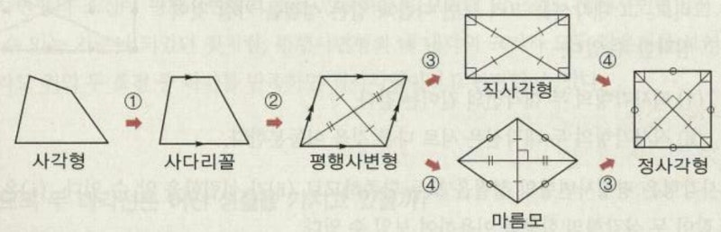
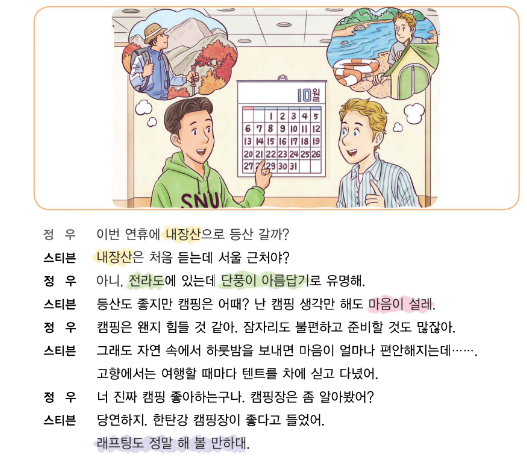

# Seoul 3B - Bài 16: 심리 상태 + 모양

**갖다**

# **사각형 = hình 4 góc**

- **정사각형** → hình vuông
👉 **정** = “chuẩn” → vuông chuẩn

**각형:** angulation

- **직사각형** → hình chữ nhật
👉 **직** = “thẳng” → góc vuông nhưng dài
- **부등변사각형** → hình thang
👉 부등변 = “cạnh không bằng” (unequal-sided)
- **평행사변형** → hình bình hành
👉 평행 = song song
- 마름모: Hình thoi (diamond): ***Hình tứ giác có bốn cạnh dài bằng nhau và hai đường chéo vuông góc với nhau ở giữa***

---

## 🧠 2. Nhóm “hình tròn & biến thể”

- **동그라미** → hình tròn
👉 giống từ “roundy” → tròn tròn
- **타원형** → hình bầu dục
👉 타원 = ellipse (hay gặp trong toán)

**울퉁불퉁: ruggedly, jaggedly**

쥐: mouse

손재주가 종다: dexterity (khéo tay)

**가장 일찍 sớm nhất**

야경: night view (cảnh đêm)

참다: endure, withstand

**평생 함께하다: gắn bó cả đời**

- **한탄강**: sông Hantan *(Hantan River)*
- **캠핑장**: khu cắm trại *(campground)*
- **베토벤**: Beethoven *(Beethoven)*
- **동강**: sông Dong *(Dong River)*
- **래프팅**: chèo thuyền vượt thác *(rafting)*

- **만리장성**: Vạn Lý Trường Thành *(Great Wall of China)*

# NGỮ PHÁP

## **1. N만 하다**

- Bạn đã thấy con chuột to bằng con mèo chưa?

⇒ 고양이**만 한** 쥐를 본 적이 있어요?

- Chắc cùng gene di truyền nên tôi cũng thấp như bố

⇒ 아마 유전자가 **같아서** 저도 아빠**처럼** 키가 작네요.

⇒ 저는 키가 작아요. 유전자가 비슷한 것 같아서 아버지**만 해요.**

## 2. V(으)ㄹ 생각도 못 하다:

- Vì quá mệt nên tôi không dám nghĩ đến việc leo núi (등산하다: leo núi)

⇒ 하도 피곤해서 등산할 생각도 못 해요

VD: 대학교를 졸업**한 지 3년 되었**습니다 Tôi đã tốt nghiệp đại học được 3 năm.

- Vì bắt đầu viết báo cáo chưa được bao lâu nên không dám nghĩ đến việc sẽ hoàn thành trong hôm nay

⇒ 보고서를 쓰기 시작한지 얼마 안 되었는데 저는 완성**할 생각도 못 해요**

**(ㅇ)ㄹ뿐만 아니라**…: Không những mà còn

- Vì tôi không những thấp mà người còn xấu nữa nên không dám nghĩ đến việc sẽ trở thành người mẫu

⇒ 저는 키가 작**을 뿐만 아니라** 나빠서 모델이 될 생각도 못 해요.

## 3. V(으)ㄹ 만하다: ****Đáng làm V (đáng xem, **đáng** ăn thử)

- Ở nhà hàng này có rất nhiều món đáng ăn thử

⇒ 식당에 우리가 먹어 **볼 만한** 음식이 많이 있어요.

- Bằng đời sống mẫu mực, Minsu là người đáng để tôi học hỏi

⇒ **모범**한 삶으로 민수는 제가 배**울 만한** 사람이에요.

- Trên đời này có rất nhiều mục tiêu đáng để chúng ta theo đuôi

⇒ 이 세상에 우리는 **추구할 만한** 목표가 많아요.

## 4. A/V 기로/ N(으)로 유명하다: Nổi tiếng với

- Đảo Jeju nổi tiếng với cảnh đẹp thu hút

⇒ 제주도는 **매력적인** **경치**로 유명해요.

# LISTENING 0: 33’10

### **-기로 했다:** 출퇴근 시간에는 차가 밀리니까 조금 일찍 나가<u>**기로 해요.**</u>

Vì giờ đi làm hay tắc đường nên tôi quyết định đi sớm một chút.
• Trong tiếng Việt tương đương với: **“quyết định, định sẽ, hứa sẽ”**

• Thường dùng dưới dạng **-기로 했다** thể hiện việc đã quyết định, quyết tâm làm việc gì đó.

### **V + (으)려고 하다**

**Định làm gì, có ý định làm gì** (dự định trong tương lai, chưa chắc chắn).

- 친구를 만나**려고 해요**. → Tôi định gặp bạn.
- 내일부터 **운동을 시작**하**려고 해요**.→ Tôi định bắt đầu tập thể dục từ ngày mai.

### **(으)러 가다/오다/다니다: Đi đến đâu...để làm gì ...**

백화점에 선물을 <u>사러 가요</u>. (=선물을 <u>사러</u> 백화점에 <u>가요</u>.)

Tôi đến tiệm bách hóa để mua quà.식당에 저녁을 <u>먹으러 가요</u>. (=저녁을 <u>먹으러</u> 식당에 <u>가요.</u>)

Tôi đến nhà hàng để ăn tối.

## 📄 **Nguyên văn (Korean)**

남: 이번 주말에 뭐 해요?

여: 오랜만에 가족하고 캠핑 가**기로** 했어요.

남: 재미있겠네요. 요즘 날씨가 좋아서 캠핑하면 아주 좋을 거예요.

여: 네. 그동안 일이 많아서 힘들었는데 캠핑 가서 스트레스 다 풀고 오려고요. 민수 씨는 주말에 뭐 해요?

남: 저는 요즘 **시간이 나**면 **낚시하**러 가요. 조용하고 경치 좋은 곳에서 낚시를 하면 기분이 정말 좋아져요.

여: 다음에 낚시하러 갈 때 **따라가**도 돼요? **전부터** 낚시를 한번 배워 보고 싶었어요.

남: 좋아요. 그럼 다음에 낚시할 수 있는 곳으로 캠핑을 **떠나**면 어때요?

여: **그거 좋은 생각인데요.**

---

## 🇻🇳 **Dịch tiếng Việt**

Nam: Cuối tuần này bạn làm gì?

Nữ: Lâu rồi nên mình quyết định đi cắm trại với gia đình.

Nam: Nghe vui đấy. Dạo này thời tiết đẹp nên đi cắm trại sẽ rất tuyệt.

Nữ: Vâng. Dạo này công việc nhiều nên hơi mệt, mình muốn đi cắm trại để giải tỏa hết stress. Còn bạn Min-su cuối tuần làm gì?

Nam: Dạo này khi có thời gian thì tôi đi câu cá. Nếu câu cá ở nơi yên tĩnh và có cảnh đẹp thì tâm trạng sẽ rất tốt.

Nữ: Lần sau bạn đi câu cá, mình đi theo được không? Mình muốn thử học câu cá từ lâu rồi.

Nam: Được thôi. Vậy lần sau mình đi cắm trại ở nơi có thể câu cá thì sao?

Nữ: Ý đó hay đấy.

- **낚시하다** (câu cá), **낚다** (câu, bắt cá).

# LISTENING 1: 34’04

## 📘 1. Nguyên văn (tiếng Hàn)

알 리: 줄리앙 씨는 주말에 보통 뭐 해요?

줄리앙: 요즘 가야금 <u>**배우러 다니는데**</u> **무척** 재미있어요.

알 리: 가야금요? 그게 뭐예요?

줄리앙: 한국 전통 악기예요. 긴 **네모** 모양 **나무판** 위에 줄이 12개 있어요.

알 리: 아, 본 적이 있어요. 그거 **크기**가 꽤 큰 것던데……

줄리앙: 네, **사람 키만 해요.**

알 리: 그런데 **연주**는 어떻게 해요?

줄리앙: 손가락으로 줄을 누르거나 **튕겨**서 소리를 내요.

소리가 참 좋은데 알리 씨도 배워 볼래요?

알 리: 아유, 전 **음치라서 악기는 배울 생각도 못 해요.**

---

## 🇻🇳 2. Dịch nghĩa tiếng Việt

Ali: Cuối tuần thì anh Julien thường làm gì?

Julien: Dạo này tôi đang đi học đàn gayageum, rất là thú vị.

Ali: Gayageum à? Đó là gì vậy?

Julien: Là nhạc cụ truyền thống của Hàn Quốc. Trên một tấm gỗ hình chữ nhật có 12 dây.

Ali: À, tôi đã từng thấy rồi. Cái đó có vẻ khá to nhỉ…

Julien: Vâng, cao gần bằng người.

Ali: Nhưng chơi như thế nào?

Julien: Dùng ngón tay nhấn hoặc gảy dây để tạo ra âm thanh.

Âm thanh rất hay, Ali cũng thử học không?

Ali: Ôi, tôi bị mù nhạc nên đến việc học nhạc cụ cũng không dám nghĩ tới.

---

# LISTENING 2: 34’51

정우: 이번 **연휴**에 내장산으로 등산 갈까?

스티븐: **내장산은 처음 듣는데 서울 근처야**?

(Polite: "내장산은 처음 듣는데, 서울 근처예요?)

정우: 아니, 전라도에 있는데 단풍이 아름답**기로 유명해**.

스티븐: 등산도 좋지만 캠핑은 어때? 난 캠핑 생각**만 해도** 마음이 설레.

정우: 캠핑은 **왠지** 힘들 것 같아. **잠자리도 불편하고 준비할 것도 많잖아**.

스티븐: 그래도 자연 속에서 하룻밤을 보내면 마음이 얼마나 편안해지는데….

고향에서나 여행할 때마다 텐트를 차에 **싣**고 다녔어.

정우: 너 진짜 캠핑 좋아하는**구나**. 캠핑장은 좀 알아봤어?

스티븐: **당연하지**. 한탄강 캠핑장이 좋다고 들었어.

**래프팅도 정말 해 볼 만하대.**

**Ngữ pháp ~구나/군요**

(한국말을 잘하는군요! (Ồ, thì ra bạn nói tiếng Hàn giỏi thế!)

오늘이 시험이구나. (À, hôm nay là ngày thi nhỉ/ra là vậy.))

---

## 🇻🇳 2. Dịch nghĩa tiếng Việt

Jungwoo: Dịp nghỉ này đi leo núi Naejangsan nhé?

Steven: Naejangsan à? Tôi chưa nghe bao giờ, gần Seoul không?

Jungwoo: Không, ở Jeolla, nổi tiếng vì lá đỏ rất đẹp.

Steven: Leo núi cũng 좋지만 (cũng tốt) nhưng đi cắm trại thì sao? Chỉ cần nghĩ đến camping thôi là tôi đã thấy háo hức rồi.

Jungwoo: Cắm trại có vẻ hơi vất vả. Chỗ ngủ cũng bất tiện, mà còn phải chuẩn bị nhiều thứ nữa.

Steven: Nhưng nếu ở trong thiên nhiên một đêm thì tâm trạng sẽ thoải mái biết bao….

Ở quê hay mỗi lần đi du lịch tôi đều dựng lều và sống như vậy.

Jungwoo: Cậu đúng là thích camping thật đấy. Đã tìm hiểu khu cắm trại chưa?

Steven: Tất nhiên rồi. Tôi nghe nói khu cắm trại sông Hantan rất tốt.

Người ta nói rằng chèo bè vượt thác cũng rất đáng để thử.

- 빙어 낚시: câu cá băng (ice fishing smelt)
- 강원도: tỉnh Gangwon
- 스킨스쿠버: lặn biển (scuba diving)
- 제주도: đảo Jeju

빙어 낚시 (câu cá băng - ice fishing)

### 🧑‍🦱 Người A (bên trái)

1. **한국에서 수상스키를 타려면 어디로 가야 돼?**
→ Ở Hàn muốn chơi trượt nước thì phải đi đâu?
2. **고향에서는 시간이 있을 때마다 수상 스키를 탔거든. 요즘……**
→ Ở quê, cứ có thời gian là tôi đi trượt nước. Dạo này thì…

👉 Ý: Người này thích water sports

---

### 👩 Người B (bên phải)

1. **청평 호수가 수상 스키로 유명하다고 들었어.**
→ Nghe nói hồ Cheongpyeong nổi tiếng về trượt nước
2. **근데 수상 스키는 왜?**
→ Nhưng sao lại là trượt nước?

👉 Ý: hỏi lý do

---

### 🧑‍🦱 Người A tiếp

**가까운 한강에도 탈 수 있는 곳이 있다던데.**

→ Nghe nói gần sông Hàn cũng có chỗ chơi được

---

### 👩 Người B tiếp

**나는 친구들하고 양평 동반하러 가기로 했는데…**

→ Tôi định đi Yangpyeong với bạn để đi cùng (du lịch cùng)

**수상 스키도 좋지만…**

→ Trượt nước cũng tốt nhưng…

👉 Ý: đang phân vân giữa các hoạt động

---

### 🧑‍🦱 Kết thúc

**정말? 그럼 이번 주말에 나하고 같이……**

→ Thật à? Vậy cuối tuần này đi cùng tôi nhé…

# **LISTENING 3: 35’52**

# 🇰🇷 Nguyên văn (Korean)

**아들**: 여보세요. 엄마, 지금 어디 계세요? 집이세요?

**어머니**: 응, 집인데.

**아들**: 엄마, 저 좀 도와주세요. 시간이 없어서 그래요.

**어머니**: 왜? 뭐 **두고 갔니**?

**아들**: 엄마, 어떻게 아셨어요?

**어머니**: 아이고, **내가 왜 몰라**. 네가 **원래 깜빡** 잘 **잊어버리**기로 유명하잖니?

**아들**: 네, 보고서를 깜빡 잊고 집에 두고 왔어요. 오늘까지 내야 하는데……

**어머니**: 그래? 어떡하니? 내가 **갖다 줄까**?

**아들**: 아니요, 외장 하드 디스크를 안 가져 왔으니까 **우선** 하드 디스크 **좀 찾아 봐 주세요**. 제 방 책상 위에 있을 거예요.

**어머니**: 하드 디스크? 컴퓨터 말이니?

**아들**: 그게 아니고요. 엄마, 책상 위 노트북 옆에 긴 **네모 모양의 물건이** 하나 있을 거예요. 색깔은 까만색이고 크기는 휴대폰만 한데 휴대폰보다는 좀 **두꺼워요**. 짧은 **전선**이 **달려 있고요.**

**어머니**: 까맣고 휴대폰**만 한** 물건이라고 했지? 그래, 여기 있구나. 디스크라고 해서 **둥근** 모양인 줄 알**았더니** **사각형**이네. 이걸 어떻게 할까?

**아들**: 엄마, 거기에 있는 파일 하나만 이메일로 보내 주세요.

**어머니**: 파일? 얘, 내가 파일은 한 번도 안 보내 봤는데…… 어떻게 하는 거니?

**아들**: 아! 할 수 없네요. **그냥 두세요**. 제가 갈게요.

---

# 🇻🇳 Dịch tiếng Việt

**Con trai**: Alo. Mẹ ơi, mẹ đang ở đâu? Ở nhà không?

**Mẹ**: Ừ, mẹ đang ở nhà.

**Con trai**: Mẹ ơi, giúp con với. Con không có thời gian.

**Mẹ**: Sao vậy? Con để quên gì à?

**Con trai**: Mẹ, sao mẹ biết vậy?

**Mẹ**: Trời ơi, sao mẹ không biết. Con vốn nổi tiếng hay quên mà.

**Con trai**: Dạ, con quên báo cáo và để ở nhà. Hôm nay phải nộp rồi…

**Mẹ**: Vậy à? Làm sao đây? Mẹ mang cho con nhé?

**Con trai**: Không ạ, con không mang ổ cứng ngoài. Mẹ tìm giúp con cái ổ cứng trước nhé. Nó ở trên bàn trong phòng con.

**Mẹ**: Ổ cứng à? Máy tính hả?

**Con trai**: Không phải. Trên bàn cạnh laptop có một vật hình chữ nhật dài. Màu đen, cỡ điện thoại nhưng dày hơn. Có dây ngắn gắn kèm.

**Mẹ**: Vật màu đen cỡ điện thoại đúng không? Ừ, thấy rồi. Mẹ tưởng “đĩa” là hình tròn, hóa ra là hình chữ nhật. Giờ làm gì tiếp?

**Con trai**: Mẹ gửi giúp con một file qua email nhé.

**Mẹ**: File à? Mẹ chưa gửi bao giờ… làm sao vậy?

**Con trai**: À… thôi được rồi. Mẹ cứ để đó đi, con về lấy.

- 계시다: ở (to be, honorific)
- 도와주다: giúp đỡ (help)
- 두고 가다: để quên (leave behind)
- 깜빡: lỡ/quên (accidentally)
- 잊어버리다: quên (forget)
- 내다: nộp (submit)
- 어떡하다: làm sao (what to do)
- 갖다 주다: mang đến (bring)
- 외장 하드 디스크: ổ cứng ngoài (external hard drive)
- 까만색: màu đen (black)
- 두껍다: dày (thick)
- 전선: dây điện (cable)
- 달려 있다: được gắn (attached)
- 둥근: tròn (round)
- 사각형: hình chữ nhật (rectangle)
- 파일: file (file)
- 이메일: email (email)
- 보내다: gửi (send)
- 그냥 두다: cứ để (leave it)

# **LISTENING 5: 37’36**

**연**: kite

**날리다**: fly a kite

**연날리기**: Kitefyling: trò thả diều

**선생님:** 오늘은 연을 만들어 보겠어요. 한국에서 연을 만들어 본 적이 있어요?

**학생:** 아니요. 하지만 한강공원에서 아이들이 연날리기 하는 걸 본 적이 있어요. 연이 마름모 모양이고 **꼬리가** 길던데요? 한국의 연은 다 그렇게 생겼나요?

**선생님:** 그렇지 않아요. 세모, 네모, 마름모 등 여러 가지 모양이 있어요. 오늘은 이 연을 만들어 봐요.

**학생:** 이건 네모 모양이네요.

**선생님:** 그래요. 이제 만들어 볼까요? 먼저 종이 **가운데** 동그랗게 **구멍을 내**세요. 연에 구멍을 만들어 주면 연이 **잘 날**거든요.

**학생:** 구멍은 얼마나 크게 만들어야 해요?

**선생님:** 이 음악 CD만 하게 만들면 돼요. CD를 줄 테니까 종이 위에 놓고 동그라미를 그린 후에 자르세요.

**학생:** 이렇게 하면 돼요?

**선생님:** 네, 좋아요. 이제 뒤쪽에 **대나무**를 붙이고 실을 묶으면 돼요.

**학생:** **어서** 날려 보고 싶어요.

**선생님:** 그럼 나가서 한번 날려 봐요. 누가 연날리기를 잘하는지 볼까요?

**학생:** 제가 **이길걸요**. 제가 고향에서 연날리기 잘하기로 유명했거든요.

## Dịch tiếng Việt

**Giáo viên:** Hôm nay chúng ta sẽ làm diều. Bạn đã từng làm diều ở Hàn Quốc chưa?

**Học sinh:** Chưa ạ. Nhưng em đã từng thấy các bạn nhỏ thả diều ở công viên sông Hàn. Diều có hình thoi và có chiếc đuôi rất dài. Diều ở Hàn Quốc đều có hình như vậy phải không ạ?

**Giáo viên:** Không phải đâu. Có nhiều hình dạng khác nhau như hình tam giác, hình vuông, hình thoi... Hôm nay chúng ta sẽ làm chiếc diều này.

**Học sinh:** Chiếc này có hình vuông nhỉ.

**Giáo viên:** Đúng rồi. Bây giờ chúng ta bắt đầu làm nhé. Trước tiên hãy khoét một lỗ hình tròn ở giữa tờ giấy. Nếu làm một cái lỗ trên diều thì diều sẽ bay tốt hơn.

**Học sinh:** Em phải làm cái lỗ to cỡ nào ạ?

**Giáo viên:** Chỉ cần làm bằng kích thước của chiếc đĩa CD này là được. Cô sẽ đưa em chiếc CD, em đặt nó lên tờ giấy, vẽ theo hình tròn rồi cắt ra nhé.

**Học sinh:** Làm như thế này được chưa ạ?

**Giáo viên:** Được rồi, tốt lắm. Bây giờ chỉ cần gắn thanh tre vào mặt sau và buộc dây là xong.

**Học sinh:** Em muốn thử thả ngay quá.

**Giáo viên:** Vậy chúng ta ra ngoài thả thử nhé. Xem ai là người thả diều giỏi hơn nào.

**Học sinh:** Chắc chắn em sẽ thắng. Vì hồi ở quê em nổi tiếng là thả diều rất giỏi mà.

## READING

**서울 시민의 산책 장소로 유명한 한강공원이 야외 활동의 천국이라는 사실을 아는 사람은 많지 않다. 도시에서는 생각도 못 했던 활동들을 한강에서는 즐길 수 있다. 서울시는 이번 봄에 한강공원에서 즐길 수 있는 특별한 활동을 추천하고 있다.**

**Dịch:**

Không có nhiều người biết rằng Công viên sông Hàn, vốn nổi tiếng là địa điểm đi dạo của người dân Seoul, lại là thiên đường của các hoạt động ngoài trời. Tại sông Hàn, mọi người có thể trải nghiệm những hoạt động mà họ khó có thể tưởng tượng được ở trong thành phố. Mùa xuân này, chính quyền thành phố Seoul đang giới thiệu những hoạt động đặc biệt mà mọi người có thể trải nghiệm tại Công viên sông Hàn.

**Từ vựng được highlight:**

- **야외**: ngoài trời (outdoors)
- **천국**: thiên đường (paradise)
- **추천하다** → **추천하고 있다**: giới thiệu, đề xuất, khuyến nghị (recommend)
- **뚝섬**: Ttukseom – tên một khu vực ở Seoul
- **인공 암벽장**: khu/tường leo núi nhân tạo (artificial climbing wall)
- **성수기**: mùa cao điểm (peak season)
- **비수기**: mùa thấp điểm (off-season)
- **광나루**: Gwangnaru – tên một khu vực ở Seoul
- **레일 바이크**: xe đạp chạy trên đường ray (rail bike)
- **미만**: dưới, chưa đến (less than)
    - **만 6세 미만**: dưới 6 tuổi
- **좌석**: chỗ ngồi, ghế ngồi (seat)
- **대**: chiếc – đơn vị đếm xe cộ hoặc máy móc
    - **10대**: 10 chiếc
- **마련되다** → **마련돼 있다**: được chuẩn bị, trang bị hoặc bố trí sẵn (be provided/prepared)

조각보는 **주로** 물건을 **싸**거나 **선물을 포장**할 때 **썼지만**, 음식을 **덮어 두**거나 창문에 걸어 **햇빛을 가리**는 등 다양하게 사용되었습니다. 조각보는 물건의 모양이나 크기에 **관계없이** 쓸 수 있**고** 보관도 쉽다는 장점이 있습니다.

**Dịch:**

Jogakbo **chủ yếu** được dùng để bọc đồ vật hoặc gói quà, nhưng nó cũng được sử dụng theo nhiều cách khác nhau, chẳng hạn như phủ lên thức ăn hoặc treo ở cửa sổ để che ánh nắng. Jogakbo có ưu điểm là có thể sử dụng cho đồ vật bất kể hình dạng hay kích thước, đồng thời cũng dễ bảo quản.

- **싸다** → **싸거나**: gói, bọc (wrap)
- **쓰다** → **썼지만**: sử dụng, dùng (use)
- **덮다** → **덮어 두다**: phủ, đậy lên và để nguyên như vậy (cover)
- **창문**: cửa sổ (window)
- **햇빛**: ánh nắng mặt trời (sunlight)
- **가리다** → **가리는**: che, chắn (block, cover)
- **관계없이**: bất kể, không phụ thuộc vào (regardless of)

천 **조각을** **이**어서 예쁜 조각보를 만들었습니다. 옷을 만들고 남은 천을 사용했기 때문에 자연스럽게 세모, 네모, 마름모 무늬가 만들어졌습니다. 그 아름다운 색깔과 모양 때문에 조각보는 현재까지도 **뛰어난** 예술품으로 사랑받고 있습니다.

**Dịch:**

Người ta nối những mảnh vải lại với nhau để tạo thành những chiếc jogakbo đẹp mắt. Vì sử dụng những mảnh vải còn thừa sau khi may quần áo nên các họa tiết hình tam giác, hình vuông và hình thoi được hình thành một cách tự nhiên. Nhờ màu sắc và hình dáng đẹp, jogakbo cho đến ngày nay vẫn được yêu thích như một tác phẩm nghệ thuật xuất sắc.

**뛰어나다** → **뛰어난**: xuất sắc, nổi bật, ưu tú (outstanding, excellent)

- **천**: vải (cloth, fabric)
- **조각**: mảnh, miếng (piece)
- **천 조각**: mảnh vải (piece of fabric)
- **잇다** → **이어서**: nối, ghép lại (connect, join)
- **무늬**: hoa văn, họa tiết (pattern)
- **예술품**: tác phẩm nghệ thuật (work of art)
- **사랑받다** → **사랑받고 있습니다**: được yêu thích, được yêu mến (be loved)